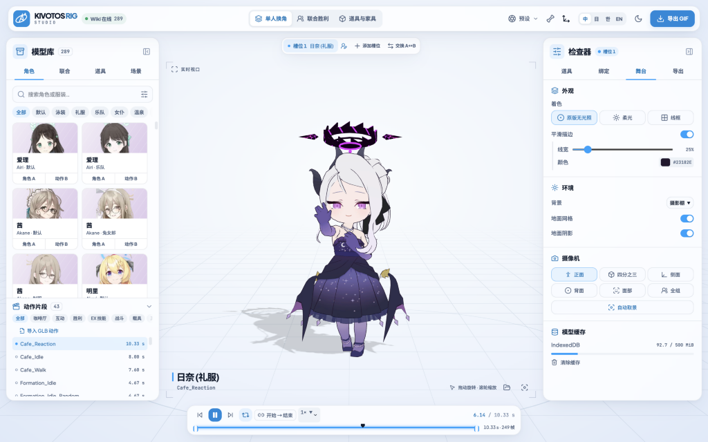
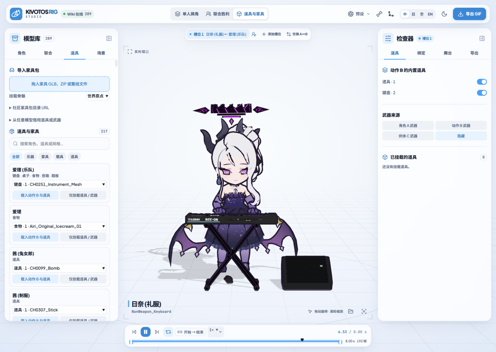
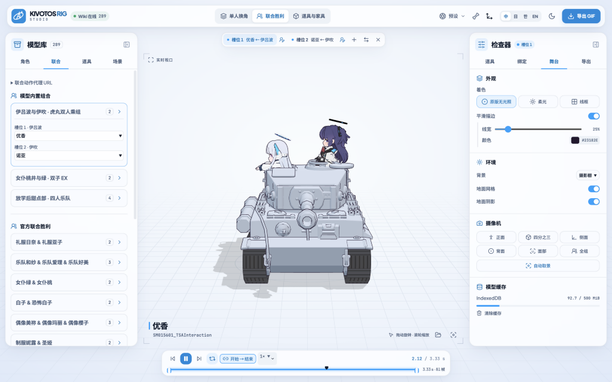
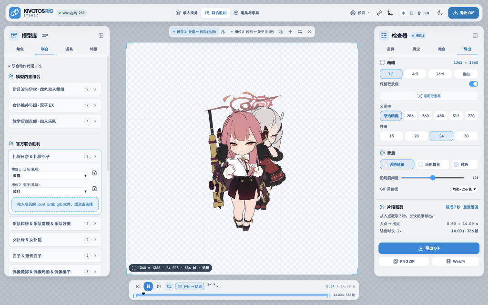
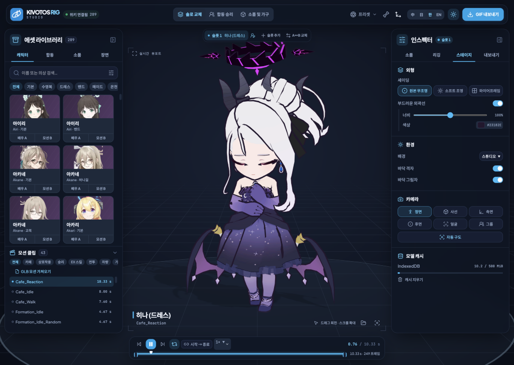
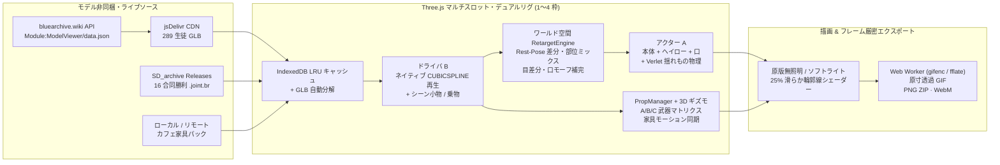

<div align="center">


# KIVOTOS RIG STUDIO

**ブルーアーカイブ 3D SD生徒 クロスリターゲット（モーション換装）・小物／家具連動・合同勝利キャスト入替・原寸透過 GIF 出力スタジオ**

<p>
  <a href="README.md">English</a> ·
  <a href="README.zh-CN.md">简体中文</a> ·
  <strong>日本語</strong> ·
  <a href="README.ko.md">한국어</a>
</p>

<p>
  
  
  
  
  
  
</p>

<br />



</div>

---

## ✨ 主な特徴

- **モデル非同梱・Wiki リアルタイム同期（リポジトリ内 `.glb` ゼロ）** — [`bluearchive.wiki`](https://bluearchive.wiki/wiki/Models) の `Module:ModelViewer/data.json` から最新 145 生徒・289 モデル一覧を直接取得し、jsDelivr CDN からオンデマンドで読み込み（ブラウザ内 IndexedDB LRU キャッシュ対応）。Wiki に新生徒や衣装が追加されると自動で反映されます。
- **デュアルリグ・ワールド空間リターゲットエンジン** — **任意の生徒 A に任意の生徒 B のモーションをそのまま適用**。バインドポーズ正規化ワールド回転転送により体型・ボーン長差を維持したまま、`CUBICSPLINE` 補間・戦車砲塔の多階層リグ（チェリノ／イロハ等）を破綻なく処理。目ボーンのローカル差分転送と `Mouth_XXX` 表情モーフの自動フォールバックにも対応します。
- **カスタムリグ編集 & Verlet 揺れもの物理** — **7 部位（頭・表情・左腕・右腕・胴体・脚・武器）**ごとにモーション B／役者 A 別クリップ／静止固定を自由ミックス。全ボーン検索付きリマップ、左右ミラー（`L ↔ R`）、3D スケルトン表示に加え、未マップの髪・スカート・翼・尻尾を Verlet スプリング物理で自然に揺らします。
- **217 モデルの内蔵小物／乗物連動 & カフェ家具パック対応** — キーボード、戦車、屋台バイク、ビーチチェア、テーブル、楽譜などの内蔵プロップを自動分解して個別 ON/OFF 可能。**A / B / C 3 系統の武器切替**と 3D `TransformControls` ギズモ、さらに外部の **カフェ家具インタラクションパック**（`.glb` / `.zip` + `pack.json`）のドラッグ＆ドロップ読み込みにも対応します。
- **公式 16 種の 2〜4 人合同勝利ポーズ & ワンクリック配役入替** — ゲーム内の全 16 合同勝利フォーメーション（および虎丸戦車タンデム・メイド双子 EX・放課後スイーツ部バンドなど）を正確な配置座標・`Start → End` 連結付きで再現し、**各スロットの生徒を 289 モデルの中から自由に入れ替え可能**。
- **フレーム厳密・原寸透過 GIF / PNG ZIP / WebM 出力** — `1:1` 正方形ファインダーがクリップ全体の動き（ヘイロー・長尺武器・小物含む）を自動フレーミング。デフォルトは **原寸（DPR 1:1 ネイティブ解像度）**、Web Worker (`gifenc`) によるクリーンな透過 GIF 出力（黒フチ・残像なし）。
- **モダン SCHALE UI & 日中韓英 4 言語切替** — **SCHALE ライト**／**Studio ダーク**の 2 テーマ対応フロストガラス UI。271 種の UI テキストと全 145 生徒名・衣装バリエーションを **日本語 / 简体中文 / 한국어 / English** でシームレスに切り替え・検索できます。

---

## 🎬 ショーケース

<table>
  <tr>
    <td width="50%" align="center">
      <br />
      <sub><strong>クロスリグ + 楽器小物連動</strong> · ヒナ(ドレス) ← アイリ(バンド) <code>NonWeapon_Keyboard</code></sub>
    </td>
    <td width="50%" align="center">
      <br />
      <sub><strong>2 スロット戦車キャスト入替</strong> · ユウカ＆ノアが虎丸に搭乗（砲塔ソケット自動追従）</sub>
    </td>
  </tr>
  <tr>
    <td width="50%" align="center">
      <br />
      <sub><strong>合同勝利 + 自動 1:1 ファインダー</strong> · アル＆ムツキ ← ヒナ＆アコ(ドレス) · <code>1368×1368</code></sub>
    </td>
    <td width="50%" align="center">
      <br />
      <sub><strong>Studio ダークテーマ + 4 言語 UI</strong> · 日 / 中 / 한 / EN をワンクリック切替</sub>
    </td>
  </tr>
</table>

<div align="center">
  <br />
  <sub><strong>実機出力した透過アニメーション GIF</strong> · アル＆ムツキ合同勝利（繊細な 25% 輪郭線・ヘイロー縁取りなし・クリーン透過）</sub>
</div>

---

## 🧠 アーキテクチャ



---

## 🚀 クイックスタート

**動作要件:** Node.js `>= 20`、npm。

```bash
git clone https://github.com/ryujou/kivotos-rig-studio.git
cd kivotos-rig-studio
npm install
npm run dev
```

ブラウザで **`http://localhost:5173`** を開くだけで利用できます。`.glb` ファイルの事前ダウンロードやバックエンド構築は不要です。

> **本番ビルド・プレビュー:**
> ```bash
> npm run build
> npm run preview
> ```

---

## 🎮 内蔵プリセット & 操作方法

上部バーの **「プリセット」** から注目の組み合わせをすぐに再生できます：

| プリセット | 見どころ |
| :--- | :--- |
| **ヒナがアイリのキーボードを演奏** | 小物ロックリターゲット + キーボード・スタンド・ペダル・スピーカー連動 |
| **アリスがチェリノの戦車を操縦** | 6 階層戦車砲塔リグ＋ルート軸差をまたぐ正確なリターゲット |
| **アズサがフウカの屋台バイクに騎乗** | 37 ボーン大型乗物プロップ同期（`CH0177_FoodBike_Outline`） |
| **ユウカ＆ノア 虎丸戦車タンデム** | イロハ＆イブキ戦車への 2 枠配役入替（副席 `St_point` 動的追従） |
| **アル＆ムツキ ペア勝利** | `/api/joint/*` Brotli プロキシ + 公式合同勝利キャスト入替 + `開始 → 終了` 連結 |
| **ホシノのミカ風コンバット** | 戦闘モーション換装 + A/B/C 武器切替 + 髪・スカート物理 |

**操作:** `左ドラッグ` 回転 · `右ドラッグ` パン · `ホイール` ズーム · 上部ギズモ（移動／回転／拡大縮小）を有効にすると、スロットや小物を 3D 空間上で直接調整できます。

---

## 🪑 カフェ家具インタラクションパック

Wiki 内蔵の **217 モデル分の小物・楽器・乗物** はそのまま利用可能です。ゲームデータから抽出した独立カフェ家具（[`ZM-Kimu/Blue-Archive-Asset-Downloader`](https://github.com/ZM-Kimu/Blue-Archive-Asset-Downloader) 等）は、**「小物」**タブへ `.glb`／複数ファイル／`.zip` をドラッグ＆ドロップするだけで全生徒と連動できます。

仕様の詳細は **[tools/README-furniture-extract.md](tools/README-furniture-extract.md)** を参照してください。

---

## ☁️ 静的ホスティング（GitHub Pages / Cloudflare Pages）

Wiki の 289 モデルおよび一覧 API は CORS 対応のため、そのまま静的公開可能です。合同勝利用 `.joint.br` パックのみ GitHub Releases のリダイレクトに CORS ヘッダが付かないため、ローカル実行時は `vite.config.ts` の `/api/joint/*` が自動中継します。静的公開時は同梱の **[deploy/cloudflare-worker.js](deploy/cloudflare-worker.js)** をデプロイし、UI 内の **「合同 → 合同モーションプロキシ URL」** に設定してください。

---

## 🙏 クレジット & 免責事項

- **3D モデルソース & ビューア参照:** [`bluearchive.wiki`](https://bluearchive.wiki/wiki/Models)、[`lihaohong6/BlueArchiveModels`](https://github.com/lihaohong6/BlueArchiveModels)、[`lihaohong6/MirahezeDevScripts`](https://github.com/lihaohong6/MirahezeDevScripts)
- **合同勝利フォーメーション・モーション調査参照:** [`dxsworks/SD_archive`](https://github.com/dxsworks/SD_archive)
- **使用ライブラリ:** [Three.js](https://threejs.org/)、[React](https://react.dev/)、[Zustand](https://zustand-demo.pmnd.rs/)、[gifenc](https://github.com/mattdesl/gifenc)、[fflate](https://github.com/101arrowz/fflate)、[Lucide](https://lucide.dev/)

> **免責事項:** 本プロジェクトは非公式・非営利のファンメイドツールであり、NEXON Games および Yostar とは一切関係ありません。『ブルーアーカイブ』に関するキャラクター・3D モデル・モーションの権利は各権利者に帰属します。本リポジトリにはゲーム由来のモデルバイナリを一切含みません。

## 📄 ライセンス

[MIT License](LICENSE) の下で公開されています。
