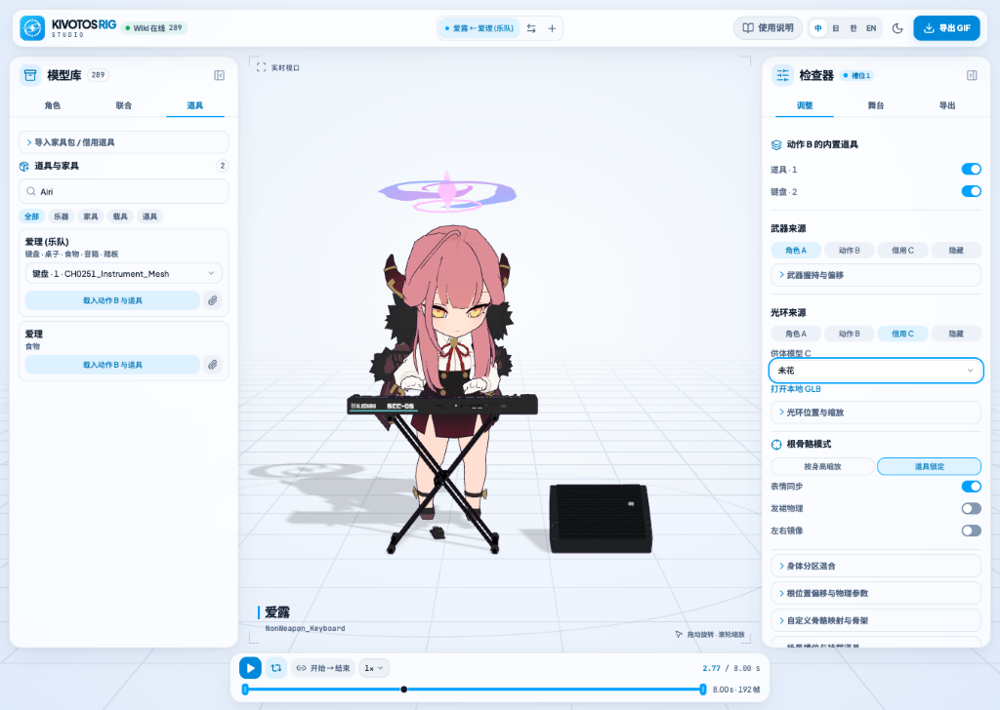
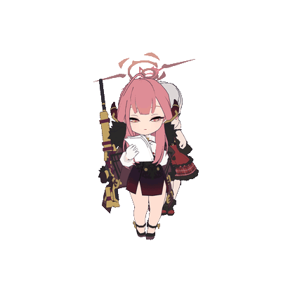

<div align="center">


# KIVOTOS RIG STUDIO

**ブルーアーカイブ 3D SD生徒 クロスリターゲット（モーション換装）・小物／家具連動・合同勝利キャスト入替・原寸透過 GIF 出力スタジオ**

<p>
  <a href="README.md">English</a> ·
  <a href="README.zh-CN.md">简体中文</a> ·
  <strong>日本語</strong> ·
  <a href="README.ko.md">한국어</a>
</p>

<p>
  <a href="https://ryujou.github.io/kivotos-rig-studio/"></a>
  
  
  
  
  
  
</p>

<p>
  <strong>👉 <a href="https://ryujou.github.io/kivotos-rig-studio/">ブラウザで今すぐ試す（GitHub Pages）</a></strong>
</p>

<br />


</div>

---

## ✨ 主な特徴

- **モデル非同梱・Wiki & SchaleDB 自動同期（リポジトリ内 `.glb` ゼロ）** — [`bluearchive.wiki`](https://bluearchive.wiki/wiki/Models) から最新 145 生徒・289 モデル一覧を取得し、jsDelivr CDN からオンデマンド読み込み。Wiki に新生徒や別衣装が追加されると、SchaleDB から 4 言語名・学園・透過立ち絵を自動補完します（週次 GitHub Actions スナップショット同期付き）。
- **直感的な「対象選択 → カード単クリック」＆統一バストアップ立ち絵カード** — 全 289 枚のカードに頭サイズを統一した透過立ち絵を採用。`/` キーで 4 言語検索、**全 145 生徒の学園フィルタ**、衣装・小物タグ、**最近選んだモデル**バーで一瞬で切替可能。
- **デュアルリグ・ワールド空間リターゲット＋破綻防止ガード** — 任意の生徒 A に任意の生徒 B のモーションを自然適用。戦車・搭乗系生徒の自動接地補正、仮面系モーションの目ボーン保護、折りたたみモーフ（`switch*`）やケーブル連動武器の自動非表示により、クロスリターゲット時のポリゴン破綻を防止します。
- **アニメ調ソフトライト、段階開示インスペクター & Verlet 揺れもの物理** — 無照明・Half-Lambert **ソフトライト**（ヘイロー・目・口・既存輪郭線を明るく保持）・ワイヤーフレームを切替可能。
- **ヘイロー交換、A/B/C 武器切替、217 モデル内蔵小物 & カフェ家具パック対応** — **ヘイローの提供元（役者 A / モーション B / 提供元 C / 非表示）** をワンクリック切替でき、位置・回転・大きさの微調整や回転・トレイル表現も維持。キーボード、戦車、屋台バイク、ビーチチェア、楽譜などの自動分解、**A / B / C 武器切替**、外部 **カフェ家具インタラクションパック**（`.glb` / `.zip` + `pack.json`）のドラッグ＆ドロップに対応。
- **公式 16 種の 2〜4 人合同勝利ポーズ & ワンクリック配役入替** — 全 16 合同勝利フォーメーション（および虎丸戦車・メイド双子 EX・スイーツ部バンド）を再現し、全スロットの生徒を自由に入れ替え可能。
- **フレーム厳密・原寸透過 GIF / PNG ZIP / WebM 出力** — `1:1` 正方形ファインダーがクリップ全体の動き（ヘイロー・長尺武器含む）を自動フレーミング。デフォルトは **原寸（1:1 DPR 解像度）**・繊細な 25% 輪郭線・ヘイロー縁取りなしの透過 GIF 出力。
- **図解付き使い方ガイド（`?`）、実機スマホ縦画面最適化 & ブラウザ言語自動判定** — スクリーンショット＋矢印注釈の 4 ステップガイド、実機スマホ（`390×580` / `390×844`）向けのフルハイトドロワー・初期折りたたみクリップ欄・余白なしトップバー、ライト／ダーク両テーマ、日中韓＋英語（その他言語は英語既定）の自動判定を完備。

---

## 🎬 ショーケース

<table>
  <tr>
    <td width="50%" align="center">
      <br />
      <sub><strong>クロスリグ楽器連動 + 提供元 C ヘイロー交換</strong> · アル ← アイリ(バンド) <code>NonWeapon_Keyboard</code> + ミカのヘイロー</sub>
    </td>
    <td width="50%" align="center">
      <br />
      <sub><strong>図解付き使い方ガイド（<code>?</code>）</strong> · 4 言語対応の矢印注釈チュートリアル</sub>
    </td>
  </tr>
  <tr>
    <td width="50%" align="center">
      <br />
      <sub><strong>合同勝利 + 自動 1:1 原寸ファインダー</strong> · ヒナ(ドレス)＆アコ(ドレス) · 透過出力</sub>
    </td>
    <td width="50%" align="center">
      <br />
      <sub><strong>Studio ダーク + ソフトライト + 日本語 UI</strong> · 日 / 中 / 한 / EN ワンクリック切替</sub>
    </td>
  </tr>
</table>

<div align="center">
  <br />
  <sub><strong>実機出力した透過アニメーション GIF</strong> · アル＆ムツキ合同勝利（繊細な 25% 輪郭線・ヘイロー縁取りなし・クリーン透過）</sub>
</div>

---

## 🚀 クイックスタート

```bash
git clone https://github.com/ryujou/kivotos-rig-studio.git
cd kivotos-rig-studio
npm install
npm run dev
```

ブラウザで **`http://localhost:5173`** を開くだけです。ショートカット：`/` 検索フォーカス · `Space` 再生／停止 · `←` / `→` 1 フレーム送り · 左ドラッグ回転 · 右ドラッグ移動 · ホイールズーム。

回帰テストはメモリ上で生成したモデルを使い、オフラインで実行できます。`npm test` で Node のテストを実行し、`npm run test:coverage` で V8 のカバレッジを確認できます。両コマンドとも Node.js 25.9 で動作確認済みです。

---

## 🪑 カフェ家具パック & ☁️ GitHub Pages デプロイ

- **家具パック仕様:** [tools/README-furniture-extract.md](tools/README-furniture-extract.md)
- **GitHub Pages 自動公開:** [.github/workflows/deploy-pages.yml](.github/workflows/deploy-pages.yml) により `main` へのプッシュで **`https://ryujou.github.io/kivotos-rig-studio/`** へ自動デプロイされます。静的公開環境で公式 16 種の `.joint.br` 合同勝利を使う場合は、**「合同 → オフラインファイル / プロキシ」** からファイルドロップまたは同梱の [deploy/cloudflare-worker.js](deploy/cloudflare-worker.js) の URL を設定してください。

---

## 🙏 クレジット & 免責事項

- **3D モデルソース:** [`bluearchive.wiki`](https://bluearchive.wiki/wiki/Models)、[`lihaohong6/BlueArchiveModels`](https://github.com/lihaohong6/BlueArchiveModels)、[`lihaohong6/MirahezeDevScripts`](https://github.com/lihaohong6/MirahezeDevScripts)
- **合同勝利・動作調査参考:** [`dxsworks/SD_archive`](https://github.com/dxsworks/SD_archive)

> **免責事項:** 本プロジェクトは非公式・非営利のファンメイドツールであり、NEXON Games および Yostar とは一切関係ありません。本リポジトリにはゲーム由来のモデルバイナリを一切含みません。

## 📄 ライセンス

[MIT License](LICENSE)
