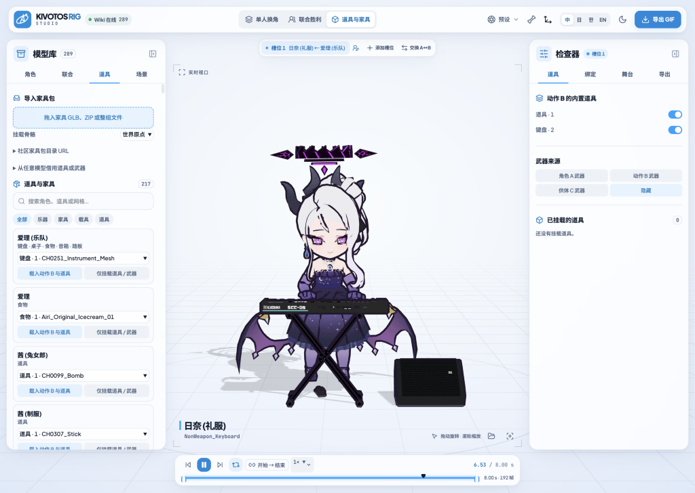
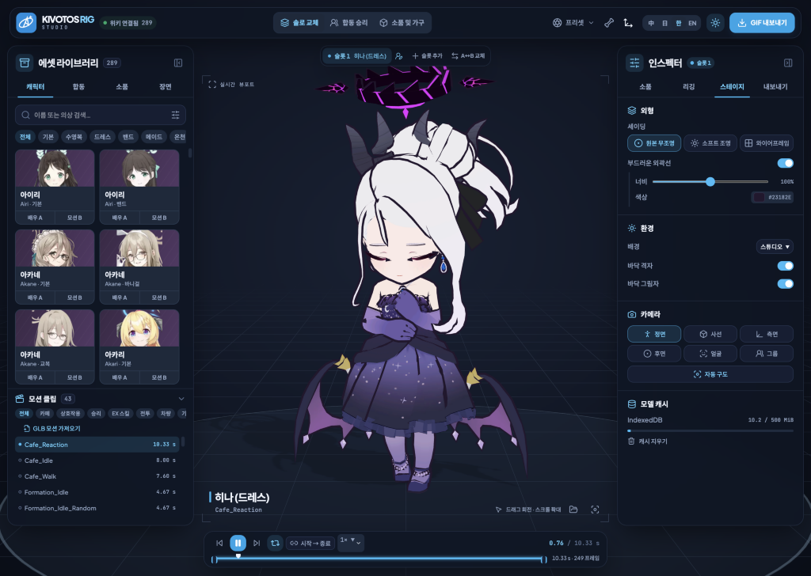
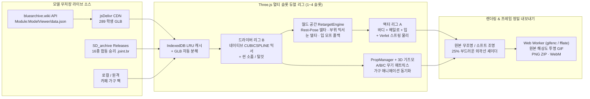

<div align="center">


# KIVOTOS RIG STUDIO

**블루 아카이브 3D SD 학생 크로스 리타게팅(본 스왑) · 소품 및 가구 상호작용 · 멀티 슬롯 합동 승리 캐스트 교체 · 원본 해상도 투명 GIF 스튜디오**

<p>
  <a href="README.md">English</a> ·
  <a href="README.zh-CN.md">简体中文</a> ·
  <a href="README.ja.md">日本語</a> ·
  <strong>한국어</strong>
</p>

<p>
  
  
  
  
  
  
</p>

<br />


</div>

---

## ✨ 주요 기능

- **모델 무저장 · 위키 실시간 연동 (저장소 내 `.glb` 0개)** — [`bluearchive.wiki`](https://bluearchive.wiki/wiki/Models)의 `Module:ModelViewer/data.json`에서 최신 145명 학생 / 289개 모델 카탈로그를 직접 불러오고 jsDelivr CDN에서 온디맨드로 스트리밍하며 브라우저 IndexedDB LRU 캐시에 저장합니다. 위키에 신규 학생·의상이 추가되면 자동 반영됩니다.
- **듀얼 리그 월드 공간 스켈레톤 리타게팅** — **어떤 학생 A에게도 어떤 학생 B의 모션을 자연스럽게 적용**합니다. 바인드 포즈 정규화 월드 쿼터니언 전송으로 체형/본 길이를 그대로 보존하며, `CUBICSPLINE` 보간, 6단계 전차 포탑 계층(체리노·이로하 등), 눈 본 로컬 델타 전송 및 `Mouth_XXX` 모프 타겟 자동 폴백을 완벽히 처리합니다.
- **커스텀 본 매핑 & Verlet 스프링 물리** — **7개 신체 부위(머리·표정·왼팔·오른팔·몸통·다리·무기)**를 모션 B / 액터 A 보조 클립 / 정지 잠금으로 자유롭게 믹싱할 수 있습니다. 검색 가능한 개별 본 리매핑, 좌우 미러링(`L ↔ R`), 3D 스켈레톤 오버레이, 미매핑 머리카락·치마·날개·꼬리용 Verlet 스프링 물리를 지원합니다.
- **217개 모델 내장 소품·탈것 연동 & 카페 가구 팩 프로토콜** — 키보드, 전차, 푸드바이크, 비치체어, 테이블, 악보 등 217개 모델의 내장 소품을 자동 분류해 개별 토글할 수 있습니다. **A / B / C 3자 무기 매트릭스**, 3D `TransformControls` 기즈모, **카페 가구 상호작용 팩**(`.glb` / `.zip` + `pack.json`) 드래그 앤 드롭을 지원합니다.
- **공식 16종 2~4인 합동 승리 포즈 & 원클릭 배역 교체** — 인게임 공식 16개 합동 승리 조합(및 토라마루 전차 텐덤·메이드 쌍둥이 EX·방과후 디저트부 4인 밴드)을 정확한 배치 좌표와 `Start → End` 연결 재생으로 제공하며, **각 슬롯의 학생을 289개 모델 중 누구로든 원클릭 교체**할 수 있습니다.
- **프레임 정밀 · 원본 해상도 투명 GIF / PNG ZIP / WebM 내보내기** — 기본 `1:1` 정사각형 뷰파인더가 클립 전체 구간을 샘플링해 헤일로·긴 무기·소품까지 깔끔하게 감싸며, 기본 **원본 해상도(1:1 네이티브 DPR 픽셀)**와 `gifenc` Web Worker 기반 깔끔한 투명 GIF(외곽선 번짐·잔상 없음)를 출력합니다.
- **모던 SCHALE 스튜디오 UI & 한/중/일/영 4개 국어** — **SCHALE 라이트** & **Studio 다크** 프로스트 글래스 워크벤치를 제공하며, 271개 UI 텍스트와 145명 학생 이름·의상 태그 전체를 **한국어 / 简体中文 / 日本語 / English**로 즉시 전환 및 검색할 수 있습니다.

---

## 🎬 쇼케이스

<table>
  <tr>
    <td width="50%" align="center">
      <br />
      <sub><strong>크로스 리그 + 악기 소품 연동</strong> · 히나(드레스) ← 아이리(밴드) <code>NonWeapon_Keyboard</code></sub>
    </td>
    <td width="50%" align="center">
      <br />
      <sub><strong>2슬롯 전차 배역 교체</strong> · 유우카 &amp; 노아 토라마루 탑승 (포탑 소켓 실시간 추적)</sub>
    </td>
  </tr>
  <tr>
    <td width="50%" align="center">
      <br />
      <sub><strong>합동 승리 + 자동 1:1 뷰파인더</strong> · 아루 &amp; 무츠키 ← 히나 &amp; 아코(드레스) · <code>1368×1368</code></sub>
    </td>
    <td width="50%" align="center">
      <br />
      <sub><strong>Studio 다크 모드 + 한국어 UI</strong> · 한 / 中 / 日 / EN 원클릭 전환</sub>
    </td>
  </tr>
</table>

<div align="center">
  <br />
  <sub><strong>실제 프레임 정밀 투명 GIF 결과물</strong> · 아루 &amp; 무츠키 합동 승리 (섬세한 25% 외곽선, 헤일로 테두리 제거, 깔끔한 알파 매트)</sub>
</div>

---

## 🧠 아키텍처



---

## 🚀 빠른 시작

**요구 사항:** Node.js `>= 20`, npm.

```bash
git clone https://github.com/ryujou/kivotos-rig-studio.git
cd kivotos-rig-studio
npm install
npm run dev
```

브라우저에서 **`http://localhost:5173`** 에 접속하면 바로 사용할 수 있으며, 로컬에 `.glb` 파일을 미리 받을 필요가 없습니다.

> **프로덕션 빌드 & 미리보기:**
> ```bash
> npm run build
> npm run preview
> ```

---

## 🎮 내장 프리셋 & 조작법

상단 바의 **「프리셋」** 메뉴에서 대표 장면을 원클릭으로 체험할 수 있습니다:

| 프리셋 | 핵심 포인트 |
| :--- | :--- |
| **히나의 아이리 키보드 연주** | 소품 잠금 리타게팅 + 키보드·스탠드·페달·스피커 동기화 |
| **아리스의 체리노 전차 조종** | 6단계 전차 포탑 계층 + 루트 축 차이 보정 |
| **아즈사의 후우카 푸드바이크** | 37본 대형 탈것 소품 동기화 (`CH0177_FoodBike_Outline`) |
| **유우카 & 노아 토라마루 탠덤** | 이로하 & 이부키 전차 2슬롯 배역 교체 (조수석 `St_point` 추적) |
| **아루 & 무츠키 듀오 승리** | `/api/joint/*` Brotli 프록시 + 공식 합동 승리 배역 교체 + `시작 → 종료` 연결 |
| **호시노의 미카 스타일 전투** | 전투 모션 스왑 + A/B/C 무기 전환 + 머리카락·치마 물리 |

**뷰포트 조작:** `좌클릭 드래그` 회전 · `우클릭 드래그` 이동 · `스크롤` 줌 · 상단 기즈모(`이동`/`회전`/`크기`)를 활성화하면 3D 공간에서 슬롯과 소품을 직접 미세 조정할 수 있습니다.

---

## 🪑 카페 가구 상호작용 팩

위키 모델에 내장된 **217개 소품·악기·탈것**은 즉시 사용할 수 있으며, 게임 에셋에서 추출한 독립 카페 가구([`ZM-Kimu/Blue-Archive-Asset-Downloader`](https://github.com/ZM-Kimu/Blue-Archive-Asset-Downloader) 등)는 **「소품」** 탭에 `.glb` / 복수 파일 / `.zip` 을 드래그 앤 드롭하여 모든 학생과 자유롭게 연동할 수 있습니다.

자세한 `pack.json` 규격은 **[tools/README-furniture-extract.md](tools/README-furniture-extract.md)** 를 참고하세요.

---

## ☁️ 정적 배포 (GitHub Pages / Cloudflare Pages)

289개 위키 학생 모델과 목록 API는 CORS를 기본 지원하므로 정적 호스팅에 바로 배포할 수 있습니다. 공식 합동 승리 `.joint.br` 팩은 GitHub Releases 리다이렉트에 CORS 헤더가 없어 로컬에서는 `vite.config.ts`의 `/api/joint/*`가 자동 중계하며, 정적 사이트 배포 시 동봉된 **[deploy/cloudflare-worker.js](deploy/cloudflare-worker.js)** 를 배포해 UI의 **「합동 → 합동 모션 프록시 URL」** 에 입력하면 됩니다.

---

## 🙏 크레딧 & 면책 조항

- **3D 모델 소스 & 뷰어 참고:** [`bluearchive.wiki`](https://bluearchive.wiki/wiki/Models), [`lihaohong6/BlueArchiveModels`](https://github.com/lihaohong6/BlueArchiveModels), [`lihaohong6/MirahezeDevScripts`](https://github.com/lihaohong6/MirahezeDevScripts)
- **합동 승리 조합 및 애니메이션 조사 참고:** [`dxsworks/SD_archive`](https://github.com/dxsworks/SD_archive)
- **주요 오픈소스:** [Three.js](https://threejs.org/), [React](https://react.dev/), [Zustand](https://zustand-demo.pmnd.rs/), [gifenc](https://github.com/mattdesl/gifenc), [fflate](https://github.com/101arrowz/fflate), [Lucide](https://lucide.dev/)

> **면책 조항:** 본 프로젝트는 비공식·비영리 팬 메이드 웹 도구이며 NEXON Games 및 Yostar와 관련이 없습니다. *블루 아카이브* 의 캐릭터, 3D 모델, 애니메이션에 대한 권리는 원저작권자에게 있으며, 본 저장소에는 저작권이 있는 게임 모델 바이너리가 전혀 포함되어 있지 않습니다.

## 📄 라이선스

[MIT License](LICENSE) 로 배포됩니다.
