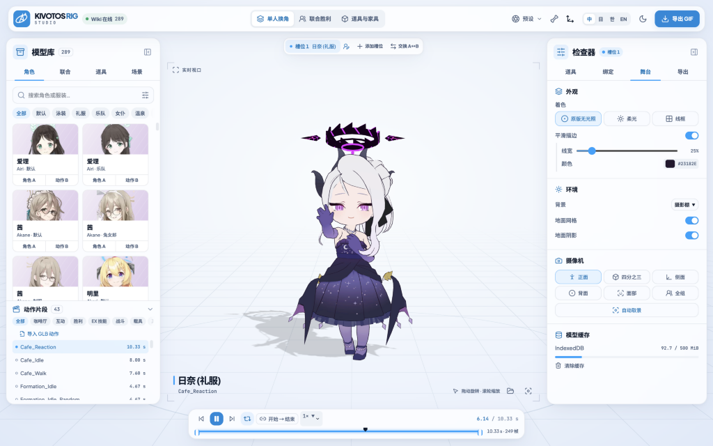
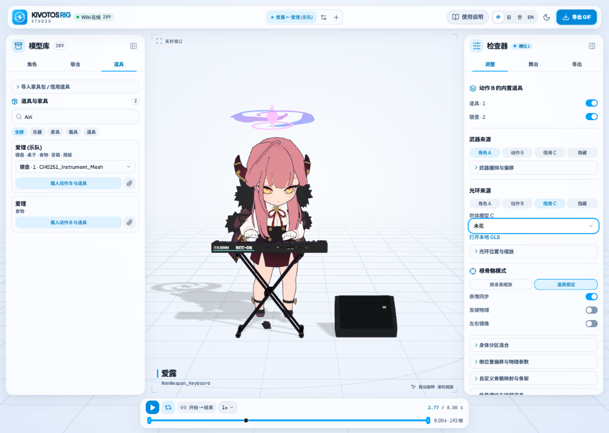
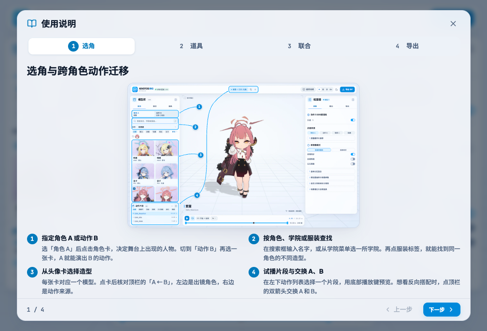
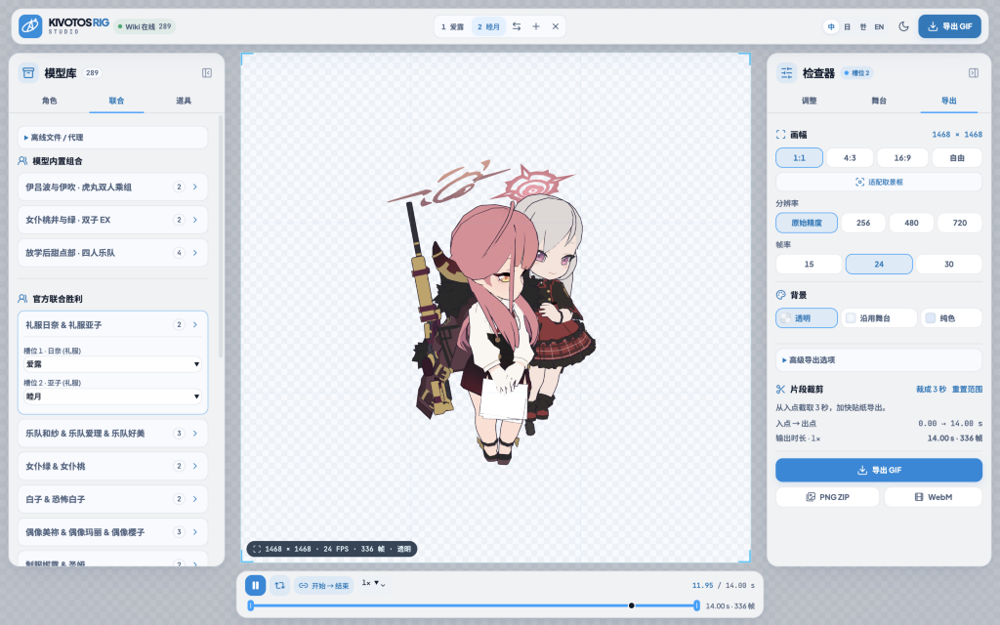
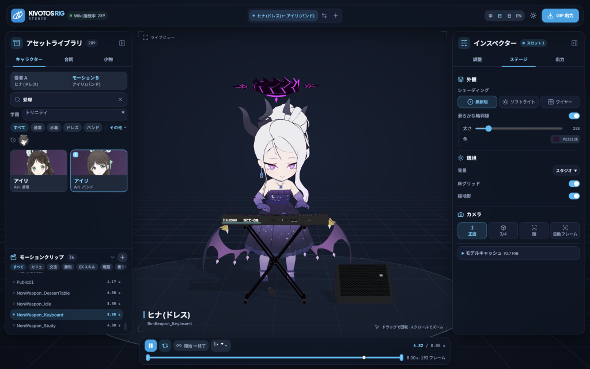
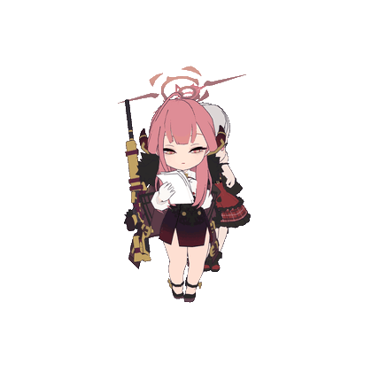

<div align="center">


# KIVOTOS RIG STUDIO

**블루 아카이브 3D SD 학생 크로스 리타게팅(본 스왑) · 소품 및 가구 상호작용 · 멀티 슬롯 합동 승리 캐스트 교체 · 원본 해상도 투명 GIF 스튜디오**

<p>
  <a href="README.md">English</a> ·
  <a href="README.zh-CN.md">简体中文</a> ·
  <a href="README.ja.md">日本語</a> ·
  <strong>한국어</strong>
</p>

<p>
  <a href="https://ryujou.github.io/kivotos-rig-studio/"></a>
  
  
  
  
  
  
</p>

<p>
  <strong>👉 <a href="https://ryujou.github.io/kivotos-rig-studio/">브라우저에서 바로 체험하기 (GitHub Pages)</a></strong>
</p>

<br />



</div>

---

## ✨ 주요 기능

- **모델 무저장 · 위키 & SchaleDB 자동 동기화 (저장소 내 `.glb` 0개)** — [`bluearchive.wiki`](https://bluearchive.wiki/wiki/Models)의 최신 145명 학생 / 289개 모델 카탈로그를 실시간 스트리밍하며, 위키에 신규 학생·의상이 추가되면 SchaleDB에서 4개 국어 이름·학원·투명 일러스트를 자동 보완합니다(주간 GitHub Actions 스냅샷 동기화 포함).
- **직관적인 「대상 선택 → 카드 클릭」 및 균일 두상 투명 일러스트 카드** — 모든 289개 카드에 머리 크기를 균일하게 맞춘 투명 상반신 일러스트를 적용했습니다. `/` 키 4개 국어 검색, **145명 공식 학원 필터**, 의상·소품 태그, **최근 선택** 바를 지원합니다.
- **듀얼 리그 월드 공간 리타게팅 + 메쉬 깨짐 방지 가드** — 어떤 학생 A에게도 어떤 학생 B의 모션을 자연스럽게 적용합니다. 차량·탑승 학생의 크로스 리타게팅 자동 접지 보정, 가면 캐릭터 눈 트랙 보호, 접힌 `switch*` 모프와 케이블 연결 무기 자동 숨김으로 폴리곤 깨짐을 방지합니다.
- **애니메이션 소프트 조명, 단계적 조정 패널 & Verlet 스프링 물리** — 원본 무조명, 커스텀 Half-Lambert **소프트 조명**(헤일로·눈·입·베이크 외곽선 유지), 와이어프레임을 지원합니다.
- **헤일로 교체, A/B/C 무기 매트릭스, 217개 내장 소품 & 카페 가구 팩** — **헤일로 출처(배우 A / 모션 B / 제공자 C / 숨기기)** 를 원클릭 전환하며 회전·트레일 애니메이션 유지 및 위치·회전·크기 미세 조정을 지원합니다. 키보드·전차·푸드바이크·비치체어·악보 등 217개 모델의 내장 소품 개별 제어, **A / B / C 무기 매트릭스**, 외부 **카페 가구 상호작용 팩**(`.glb` / `.zip` + `pack.json`) 드래그 앤 드롭을 지원합니다.
- **공식 16종 2~4인 합동 승리 포즈 & 원클릭 배역 교체** — 16개 공식 합동 승리 조합(및 토라마루 전차·메이드 쌍둥이 EX·방과후 디저트부 4인 밴드)을 정확한 좌표와 `시작 → 종료` 연결로 재생하며 모든 슬롯을 원하는 학생으로 즉시 교체할 수 있습니다.
- **프레임 정밀 · 원본 해상도 투명 GIF / PNG ZIP / WebM 내보내기** — `1:1` 정사각형 뷰파인더가 클립 전체 구간(헤일로·긴 무기 포함)을 자동 프레이밍하며 기본 **원본 해상도(1:1 DPR)**와 섬세한 25% 외곽선, 깔끔한 투명 GIF를 출력합니다.
- **도해 사용 안내(`?`), 실기기 모바일 세로 최적화 & 브라우저 언어 자동 감지** — 스크린샷과 화살표 주석이 포함된 4단계 안내 창, 실기기 폰(`390×580` / `390×844`)용 풀하이트 드로어·기본 접힘 클립 바·여백 없는 단일 행 상단 바, 라이트/다크 테마, 한·중·일 자동 감지(그 외 영어 기본)를 지원합니다.

---

## 🎬 쇼케이스

<table>
  <tr>
    <td width="50%" align="center">
      <br />
      <sub><strong>크로스 리그 악기 + 제공자 C 헤일로 교체</strong> · 아루 ← 아이리(밴드) <code>NonWeapon_Keyboard</code> + 미카 헤일로</sub>
    </td>
    <td width="50%" align="center">
      <br />
      <sub><strong>도해 사용 안내 (<code>?</code>)</strong> · 4개 국어 화살표 주석 워크스루</sub>
    </td>
  </tr>
  <tr>
    <td width="50%" align="center">
      <br />
      <sub><strong>합동 승리 + 자동 1:1 원본 뷰파인더</strong> · 히나(드레스) &amp; 아코(드레스) · 투명 내보내기</sub>
    </td>
    <td width="50%" align="center">
      <br />
      <sub><strong>Studio 다크 + 소프트 조명 + 4개 국어 UI</strong> · 한 / 中 / 日 / EN 원클릭 전환</sub>
    </td>
  </tr>
</table>

<div align="center">
  <br />
  <sub><strong>실제 프레임 정밀 투명 GIF 결과물</strong> · 아루 &amp; 무츠키 합동 승리 (25% 외곽선, 헤일로 테두리 제거, 깔끔한 투명 매트)</sub>
</div>

---

## 🚀 빠른 시작

```bash
git clone https://github.com/ryujou/kivotos-rig-studio.git
cd kivotos-rig-studio
npm install
npm run dev
```

브라우저에서 **`http://localhost:5173`** 에 접속하면 바로 시작됩니다. 단축키: `/` 검색 포커스 · `Space` 재생/일시정지 · `←` / `→` 1프레임 이동 · 좌클릭 회전 · 우클릭 이동 · 스크롤 줌.

회귀 테스트는 메모리에서 생성한 모델을 사용하며 오프라인으로 실행할 수 있습니다. `npm test`로 Node 테스트를 실행하고 `npm run test:coverage`로 V8 커버리지를 확인할 수 있습니다. 두 명령 모두 Node.js 25.9에서 검증했습니다.

---

## 🪑 카페 가구 팩 & ☁️ GitHub Pages 자동 배포

- **가구 팩 규격:** [tools/README-furniture-extract.md](tools/README-furniture-extract.md)
- **GitHub Pages 배포:** [.github/workflows/deploy-pages.yml](.github/workflows/deploy-pages.yml) 를 통해 `main` 푸시 시 **`https://ryujou.github.io/kivotos-rig-studio/`** 에 자동 빌드·배포됩니다. 정적 사이트에서 공식 16종 `.joint.br` 합동 승리를 사용하려면 **「합동 → 오프라인 파일 / 프록시」** 에 파일을 드롭하거나 동봉된 [deploy/cloudflare-worker.js](deploy/cloudflare-worker.js) URL을 입력하세요.

---

## 🙏 크레딧 & 면책 조항

- **3D 모델 소스:** [`bluearchive.wiki`](https://bluearchive.wiki/wiki/Models), [`lihaohong6/BlueArchiveModels`](https://github.com/lihaohong6/BlueArchiveModels), [`lihaohong6/MirahezeDevScripts`](https://github.com/lihaohong6/MirahezeDevScripts)
- **합동 승리·애니메이션 조사 참고:** [`dxsworks/SD_archive`](https://github.com/dxsworks/SD_archive)

> **면책 조항:** 본 프로젝트는 비공식·비영리 팬 메이드 웹 도구이며 NEXON Games 및 Yostar와 관련이 없습니다. 본 저장소에는 게임 모델 바이너리가 전혀 포함되어 있지 않습니다.

## 📄 라이선스

[MIT License](LICENSE)
