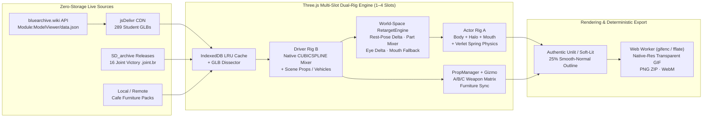

<div align="center">


# KIVOTOS RIG STUDIO

**Blue Archive 3D Chibi Cross-Character Skeleton Retargeting, Interactive Props & Furniture, Multi-Slot Joint Victory Cast-Swap & Native Transparent GIF Studio**

<p>
  <strong>English</strong> ·
  <a href="README.zh-CN.md">简体中文</a> ·
  <a href="README.ja.md">日本語</a> ·
  <a href="README.ko.md">한국어</a>
</p>

<p>
  
  
  
  
  
  
</p>

<br />


</div>

---

## ✨ Highlights

- **Zero-Storage Live Wiki Sync (`0` `.glb` files in repo)** — Streams the live 145-student / 289-model catalog directly from [`bluearchive.wiki`](https://bluearchive.wiki/wiki/Models) (`Module:ModelViewer/data.json`) and fetches `.glb` binaries on demand from jsDelivr CDN with an automatic IndexedDB LRU browser cache. New characters added on the wiki appear automatically.
- **Dual-Rig World-Space Skeleton Retargeting** — Let **any Character A perform any Character B's animation** cleanly. Rest-pose normalized world-space quaternion transfer preserves target bone lengths, handles `CUBICSPLINE` tracks natively, survives deep vehicle/turret hierarchies (e.g. Cherino/Iroha tanks), transfers eye-bone deltas without eye pop-out, and maps `Mouth_XXX` morph targets with hundred-series fallback.
- **Custom Bone Lab & Verlet Spring Physics** — Mix **7 body part groups** (`Head`, `Face`, `Left Arm`, `Right Arm`, `Torso`, `Legs`, `Weapon`) between Motion B, Actor A's own secondary clip, or Rest Lock; manually remap or mirror (`L ↔ R`) any bone with live 3D Skeleton Overlay; animate unmapped hair, skirts, wings, tails, and ribbons with deterministic Verlet spring physics.
- **Universal Prop, Weapon & Cafe Furniture Interaction** — Automatically dissects all **217 Wiki models with embedded props/instruments/furniture/vehicles** (keyboards, tanks, food bikes, beach chairs, tables, sheet music) for per-part toggling; provides an **A / B / C Three-Way Weapon Matrix** + 3D `TransformControls` Gizmo; supports drag-and-drop **Cafe Furniture Interaction Packs** (`.glb` / `.zip` + `pack.json`) and remote pack indices.
- **16 Official 2–4 Character Joint Victory Combos + 1-Click Cast Swap** — Load all 16 in-game duo/trio/quartet victory formations (plus Wiki-native duos like Toramaru Tank Tandem & Maid Twin EX) with exact `(x, z, yaw)` placements, `Start → End` chaining, and **replace any slot with any of the 289 students** in one click.
- **Deterministic Native-Resolution Transparent GIF / PNG ZIP / WebM Export** — Auto-fitting `1:1` square viewfinder encloses full character height, halos, tall weapons, and props across the clip; defaults to **Original (1:1 DPR native precision)** with clean alpha-matte transparency (`gifenc` Web Worker, disposal mode 2, zero black fringe).
- **Modern SCHALE Studio UI & Full 4-Language i18n** — Translucent frosted-glass workbench in **SCHALE Light** & **Studio Dark**, localized across **English / 简体中文 / 日本語 / 한국어** (all 271 UI keys + all 145 student names and costume variants searchable in every language).

---

## 🎬 Showcase Gallery

<table>
  <tr>
    <td width="50%" align="center">
      <br />
      <sub><strong>Cross-Rig + Instrument Prop</strong> · Hina (Dress) ← Airi (Band) <code>NonWeapon_Keyboard</code></sub>
    </td>
    <td width="50%" align="center">
      <br />
      <sub><strong>2-Slot Tank Cast Swap</strong> · Yuuka &amp; Noa riding Toramaru (live moving turret socket)</sub>
    </td>
  </tr>
  <tr>
    <td width="50%" align="center">
      <br />
      <sub><strong>Duo Joint Victory + Auto 1:1 Viewfinder</strong> · Aru &amp; Mutsuki ← Hina &amp; Ako (Dress) · <code>1368×1368</code></sub>
    </td>
    <td width="50%" align="center">
      <br />
      <sub><strong>Studio Dark Mode + 4-Language UI</strong> · Seamless switch between EN / 中 / 日 / 한</sub>
    </td>
  </tr>
</table>

<div align="center">
  <br />
  <sub><strong>Actual Deterministic Transparent GIF Output</strong> · Aru &amp; Mutsuki Duo Victory (delicate 25% outline, unlined glowing halos, zero matte fringe)</sub>
</div>

---

## 🧠 Architecture



---

## 🚀 Quick Start

**Prerequisites:** Node.js `>= 20` and npm.

```bash
git clone https://github.com/ryujou/kivotos-rig-studio.git
cd kivotos-rig-studio
npm install
npm run dev
```

Open **`http://localhost:5173`** in your browser. No local `.glb` download or backend setup is required—characters stream directly from the Wiki CDN on demand.

> **Production Build & Preview:**
> ```bash
> npm run build
> npm run preview
> ```

---

## 🎮 Built-in Presets & Controls

Open the **Presets** menu in the top bar to jump straight into ready-made scenes:

| Preset | What It Demonstrates |
| :--- | :--- |
| **Hina Plays Airi's Keyboard** | Cross-rig transfer (`prop-locked`) + embedded band keyboard, stand, pedal & monitor speaker |
| **Arisu Drives Cherino's Tank** | Deep 6-level tank turret ancestry + `bone_root` axis normalization |
| **Azusa Rides Fuuka's Food Bike** | Multi-bone vehicle prop sync (`CH0177_FoodBike_Outline`) |
| **Yuuka & Noa Tank Tandem** | 2-slot cast swap onto Toramaru with live moving `St_point` passenger socket |
| **Aru & Mutsuki Duo Victory** | Live `/api/joint/*` Brotli proxy + 2-slot official Joint Victory cast swap + `Start → End` chaining |
| **Hoshino Holds Mika's Style** | Combat retargeting + A/B/C Weapon Matrix + Verlet hair/skirt spring physics |

**Viewport Controls:** `Left Drag` Orbit · `Right Drag` Pan · `Scroll` Zoom · Click any slot/prop in **Scene** or **Props** with Gizmo enabled (`Move` / `Rotate` / `Scale`) to adjust transforms in 3D space.

---

## 🪑 Interactive Cafe Furniture Packs

All **217 Wiki models with embedded props/instruments/vehicles** work out of the box. For standalone Blue Archive Cafe furniture extracted from game bundles (e.g. via [`ZM-Kimu/Blue-Archive-Asset-Downloader`](https://github.com/ZM-Kimu/Blue-Archive-Asset-Downloader) or AssetStudio), drag-and-drop a `.glb`, multi-file selection, or `.zip` archive directly into the **Props** tab—or point to a remote pack index URL.

See **[tools/README-furniture-extract.md](tools/README-furniture-extract.md)** for the `pack.json` manifest specification and extraction workflow.

---

## ☁️ Static Deployment (GitHub Pages / Cloudflare Pages)

All 289 Wiki student `.glb` files and `Module:ModelViewer/data.json` support browser CORS natively and work on any static host. Because GitHub Release redirects for `SD_archive`'s 16 `.joint.br` packs omit CORS headers, local `vite dev` / `vite preview` proxies `/api/joint/*` automatically; for pure static hosting, deploy the included **[deploy/cloudflare-worker.js](deploy/cloudflare-worker.js)** and paste its URL into **Joint → Joint Action Proxy URL**.

---

<details>
<summary><strong>📁 Project Structure</strong></summary>

```text
kivotos-rig-studio/
├── deploy/
│   └── cloudflare-worker.js        # Optional static-host CORS proxy for .joint.br packs
├── docs/media/                     # README showcase screenshots & transparent GIF demo
├── public/                         # Halo favicon, portrait atlas, Brotli license
├── src/
│   ├── components/                 # TopBar, SlotStrip, LeftDrawer, RightInspector, TimelineDock, CropOverlay, ExportModal
│   ├── data/                       # Fallback Wiki catalog metadata, 217 prop index, 16 joint combos, presets
│   ├── engine/                     # SceneManager, ModelLoader, OutlineEffect, RetargetEngine, SpringBoneSolver, PropManager, GifExporter
│   ├── i18n/                       # Full EN / ZH / JA / KO UI dictionary + 145 student & variant names
│   ├── services/                   # Live Wiki API loader, IndexedDB LRU cache, jointLoader, furniturePack
│   ├── store/                      # Zustand multi-slot studio state & export session
│   └── workers/                    # Off-thread gifenc GIF encoder & fflate PNG ZIP bundler
├── tools/
│   └── README-furniture-extract.md # Cafe Furniture Interaction Pack format & extraction guide
└── vite.config.ts                  # Vite + Tailwind v4 + /api/joint/* Brotli proxy middleware
```

</details>

---

## 🙏 Credits & Disclaimer

- **3D Student Models & Wiki Viewer Reference:** [`bluearchive.wiki`](https://bluearchive.wiki/wiki/Models), [`lihaohong6/BlueArchiveModels`](https://github.com/lihaohong6/BlueArchiveModels), and [`lihaohong6/MirahezeDevScripts`](https://github.com/lihaohong6/MirahezeDevScripts)
- **Joint Victory Formations & Animation Survey Reference:** [`dxsworks/SD_archive`](https://github.com/dxsworks/SD_archive)
- **Core Libraries:** [Three.js](https://threejs.org/), [React](https://react.dev/), [Zustand](https://zustand-demo.pmnd.rs/), [gifenc](https://github.com/mattdesl/gifenc), [fflate](https://github.com/101arrowz/fflate), [Lucide](https://lucide.dev/)

> **Disclaimer:** This is an unofficial, non-commercial fan-made web tool and is not affiliated with NEXON Games or Yostar. All *Blue Archive* characters, 3D models, and animations belong to their respective copyright holders. No copyrighted game model binaries are stored in this repository.

## 📄 License

Released under the [MIT License](LICENSE).
