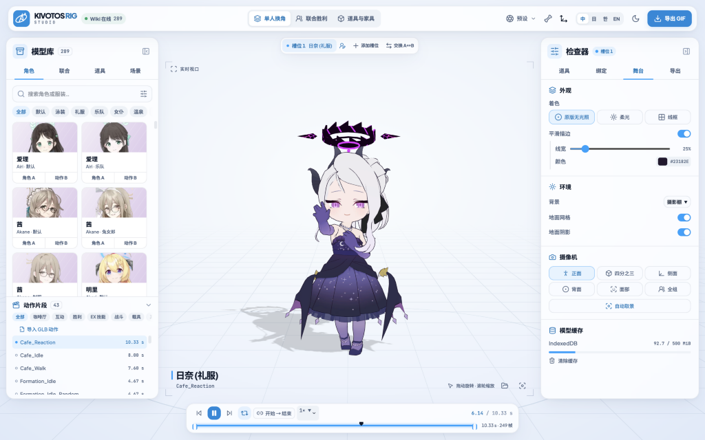
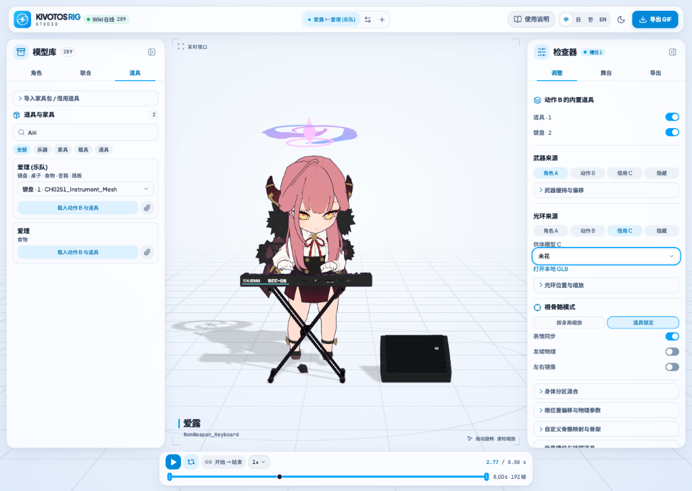
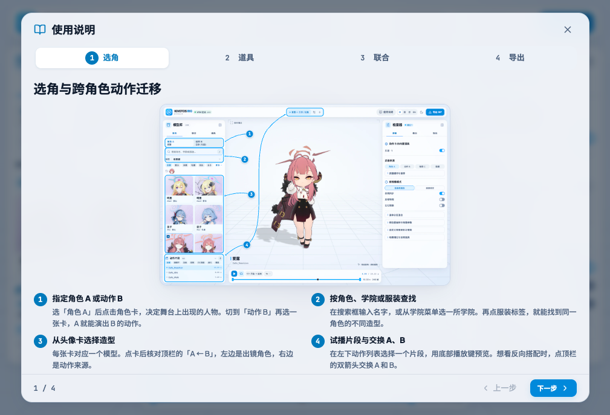
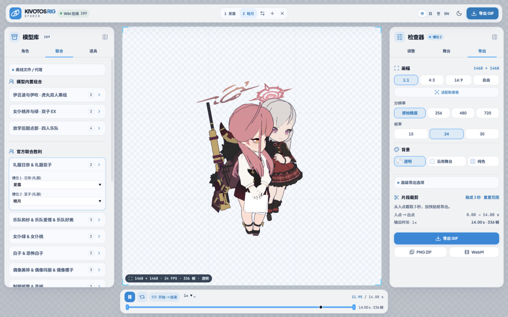
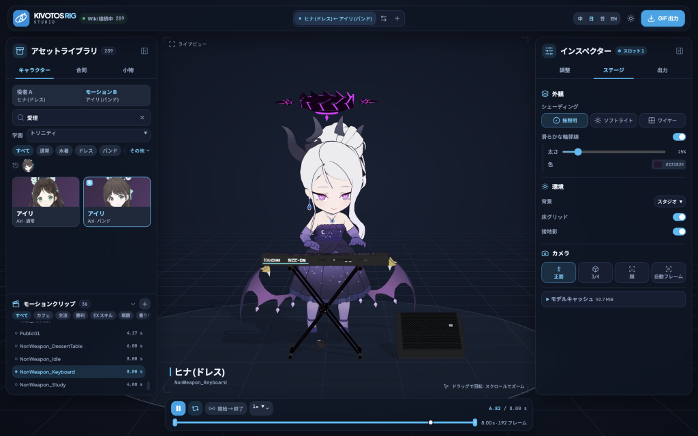
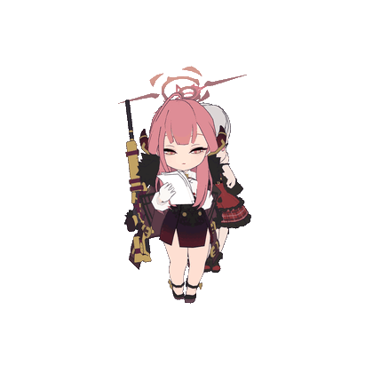
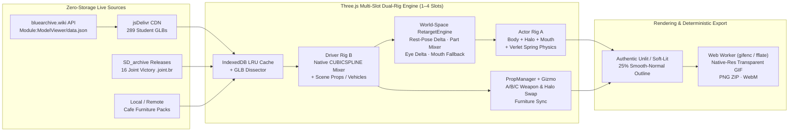

<div align="center">


# KIVOTOS RIG STUDIO

**Blue Archive 3D Chibi Cross-Character Skeleton Retargeting, Interactive Props & Furniture, Multi-Slot Joint Victory Cast-Swap & Native Transparent GIF Studio**

<p>
  <strong>English</strong> ·
  <a href="README.zh-CN.md">简体中文</a> ·
  <a href="README.ja.md">日本語</a> ·
  <a href="README.ko.md">한국어</a>
</p>

<p>
  <a href="https://ryujou.github.io/kivotos-rig-studio/"></a>
  
  
  
  
  
  
</p>

<p>
  <strong>👉 <a href="https://ryujou.github.io/kivotos-rig-studio/">Try Live in Browser (GitHub Pages)</a></strong>
</p>

<br />



</div>

---

## ✨ Highlights

- **Zero-Storage Live Wiki + SchaleDB Auto-Sync (`0` `.glb` files in repo)** — Streams the live 145-student / 289-model catalog directly from [`bluearchive.wiki`](https://bluearchive.wiki/wiki/Models) (`Module:ModelViewer/data.json`) with on-demand jsDelivr CDN loading and an IndexedDB LRU cache. When the Wiki adds a brand-new student or outfit, the app automatically enriches 4-language names, academy tags, and transparent standing art live from SchaleDB (backed by a weekly GitHub Actions snapshot sync).
- **Effortless Target-First Workflow, Uniform Bust Cards & Fast Filtering** — Pick **`Actor A`** or **`Motion B`** once and click any card directly; all 289 cards render uniformly head-framed transparent standing illustrations. Press `/` for instant multi-language search, filter by **official Academy**, outfit, or embedded props, and jump between **Recent Picks** in one click.
- **Dual-Rig World-Space Retargeting + Rig-Safety Guards** — Let **any Character A perform any Character B's animation** cleanly. Rest-pose normalized world-space quaternion transfer preserves target bone lengths, handles `CUBICSPLINE` tracks natively, survives deep vehicle/turret hierarchies, grounds tactical-support/vehicle students cleanly in cross-character mode, guards masked-face eye tracks, auto-hides collapsed switch morphs and cross-character tethered weapons (preventing polygon spikes), and maps `Mouth_XXX` morph targets with hundred-series fallback.
- **Anime Soft-Lit Shading, Progressive Rig Lab & Verlet Spring Physics** — Switch between authentic **Unlit**, custom Half-Lambert **Soft-Lit** (keeping halos, eyes, mouths, and baked outlines crisp), and **Wireframe** with `25%` smooth-normal outlines. Core rig toggles stay front and center while **7-part Body Mixer**, **Custom Bone Remapper + 3D Skeleton Overlay**, **Root/Spring Tuning**, and **3D Gizmo** expand cleanly on demand.
- **Halo Swap, Weapon Matrix, Embedded Props & Cafe Furniture Interaction** — Swap any character's **Halo (`Actor A / Motion B / Donor C / Hide`)** with head-relative upright alignment (preserving spinning/trail halo animations across elevated vehicles and multi-mesh halos) plus position/rotation/scale fine-tuning. Auto-dissects all **217 Wiki models with embedded props/instruments/furniture/vehicles** for per-part toggling; provides an **A / B / C Three-Way Weapon Matrix**; supports drag-and-drop **Cafe Furniture Interaction Packs** (`.glb` / `.zip` + `pack.json`) and remote pack indices.
- **16 Official 2–4 Character Joint Victory Combos + 1-Click Cast Swap** — Load all 16 in-game duo/trio/quartet victory formations (plus Wiki-native duos like Toramaru Tank Tandem, Maid Twin EX & After-School Sweets Band) with exact `(x, z, yaw)` placements, `Start → End` chaining, and **replace any slot with any of the 289 students**.
- **Deterministic Native-Resolution Transparent GIF / PNG ZIP / WebM Export** — Auto-fitting `1:1` square viewfinder encloses full character height, unlined glowing halos, tall weapons, and props across the clip; defaults to **Original (1:1 DPR native precision)** with clean `25%` Wiki-authentic outlines and alpha-matte transparency (`gifenc` Web Worker, disposal mode 2).
- **Illustrated User Guide (`?`), Real-Phone Mobile UI & Auto-Locale 4-Language i18n** — Built-in 4-step illustrated walkthrough with annotated arrows (`?`), real-phone mobile portrait layout (`390×580` & `390×844` full-height sheets showing 2–4 complete card rows, collapsed-by-default clip bar, uncrowded single-row TopBar, safe-area & touch-friendly timeline), **SCHALE Light** & **Studio Dark** themes, and automatic browser locale detection across **English / 简体中文 / 日本語 / 한국어** (non-CJK defaults to English).

---

## 🎬 Showcase Gallery

<table>
  <tr>
    <td width="50%" align="center">
      <br />
      <sub><strong>Cross-Rig Instrument &amp; Donor C Halo Swap</strong> · Aru ← Airi (Band) <code>NonWeapon_Keyboard</code> + Mika Halo</sub>
    </td>
    <td width="50%" align="center">
      <br />
      <sub><strong>Built-in Illustrated User Guide (<code>?</code>)</strong> · 4 annotated steps with callout arrows in 4 languages</sub>
    </td>
  </tr>
  <tr>
    <td width="50%" align="center">
      <br />
      <sub><strong>Duo Joint Victory + Auto 1:1 Native Viewfinder</strong> · Hina (Dress) &amp; Ako (Dress) · Original Transparent</sub>
    </td>
    <td width="50%" align="center">
      <br />
      <sub><strong>Studio Dark + Anime Soft-Lit + 4-Language UI</strong> · Seamless switch between EN / 中 / 日 / 한</sub>
    </td>
  </tr>
</table>

<div align="center">
  <br />
  <sub><strong>Actual Deterministic Transparent GIF Output</strong> · Aru &amp; Mutsuki Duo Victory (delicate 25% outline, unlined glowing halos, zero matte fringe)</sub>
</div>

---

## 🧠 Architecture



---

## 🚀 Quick Start

**Prerequisites:** Node.js `>= 20` and npm.

```bash
git clone https://github.com/ryujou/kivotos-rig-studio.git
cd kivotos-rig-studio
npm install
npm run dev
```

Open **`http://localhost:5173`** in your browser. No local `.glb` download or backend setup is required—characters stream directly from the Wiki CDN on demand.

> **Production Build & Preview:**
> ```bash
> npm run build
> npm run preview
> ```

The regression suite runs offline with in-memory model fixtures. Run `npm test` for the Node tests or `npm run test:coverage` for V8 coverage. Both commands have been verified with Node.js 25.9.

---

## 🎮 Studio Workflow & Controls

1. **Swap Any Character & Motion** — Choose **`Actor A`** or **`Motion B`** at the top of the **Characters** tab, press `/` to search across EN/ZH/JA/KO or filter by **Academy / Outfit**, then click any character card directly. Click `⇄` in the top bar to swap A/B or `+` to add up to 4 slots.
2. **Swap Weapons, Halos & Interact with Furniture** — Open **Props** to load any of the 217 embedded instruments/vehicles/furniture, swap **Weapons** or **Halos (`Actor A / Motion B / Donor C / Hide` + offset/rotation/scale)** in **Adjust**, or drag-and-drop local `.glb` / `.zip` **Cafe Furniture Interaction Packs** directly onto the 3D canvas.
3. **Duo & Group Joint Victories** — Open **Joint** to load Wiki-native duos/band or any of the 16 official 2–4 character victory poses, then replace any slot's student with anyone in the catalog.
4. **Export Native Transparent GIF** — Click **`Export GIF`** in the top bar to auto-frame the `1:1` square viewfinder at **Original** precision, drag the timeline In/Out trim grips (or click `Trim 3s`), and render in a Web Worker.

**Shortcuts & Viewport:** `/` Focus Search · `Space` Play/Pause · `←` / `→` Step 1 Frame · `Left Drag` Orbit · `Right Drag` Pan · `Scroll` Zoom · Expand **Adjust → Scene Slots & Mounted Props** for the 3D Gizmo (`Move` / `Rotate` / `Scale`).

---

## 🪑 Interactive Cafe Furniture Packs

All **217 Wiki models with embedded props/instruments/vehicles** work out of the box. For standalone Blue Archive Cafe furniture extracted from game bundles (e.g. via [`ZM-Kimu/Blue-Archive-Asset-Downloader`](https://github.com/ZM-Kimu/Blue-Archive-Asset-Downloader) or AssetStudio), drag-and-drop a `.glb`, multi-file selection, or `.zip` archive directly into the viewport or **Props → Import Local Furniture / Borrow Any Prop**.

See **[tools/README-furniture-extract.md](tools/README-furniture-extract.md)** for the `pack.json` manifest specification and extraction workflow.

---

## ☁️ GitHub Pages & Static Deployment

This repository includes an automated GitHub Actions Pages workflow at **[.github/workflows/deploy-pages.yml](.github/workflows/deploy-pages.yml)** deploying directly to **`https://ryujou.github.io/kivotos-rig-studio/`** on every push to `main`.

- All 289 Wiki models, 217 embedded prop setups, and 3 Wiki-native duo/band combos stream directly via CORS on GitHub Pages with zero backend.
- For the 16 official `.joint.br` victory packs on static hosting, open **Joint → Offline Files / Proxy** to drop local `.joint.br` files or paste the URL of your deployed **[deploy/cloudflare-worker.js](deploy/cloudflare-worker.js)** (local `vite dev` / `vite preview` proxies `/api/joint/*` automatically).

---

<details>
<summary><strong>📁 Project Structure</strong></summary>

```text
kivotos-rig-studio/
├── .github/workflows/
│   └── deploy-pages.yml            # Automated GitHub Pages build & deployment
├── deploy/
│   └── cloudflare-worker.js        # Optional static-host CORS proxy for .joint.br packs
├── docs/media/                     # README showcase screenshots & transparent GIF demo
├── public/                         # Halo favicon, portrait atlas, Brotli license
├── src/
│   ├── components/                 # TopBar, LeftDrawer, RightInspector, AdjustInspector, TimelineDock, CropOverlay, ExportModal
│   ├── data/                       # Fallback Wiki catalog metadata, 217 prop index, 16 joint combos
│   ├── engine/                     # SceneManager, ModelLoader, OutlineEffect, RetargetEngine, SpringBoneSolver, PropManager, GifExporter
│   ├── i18n/                       # Full EN / ZH / JA / KO UI dictionary + 145 student, academy & variant names
│   ├── services/                   # Live Wiki API loader, IndexedDB LRU cache, jointLoader, furniturePack
│   ├── store/                      # Zustand multi-slot studio state & export session
│   └── workers/                    # Off-thread gifenc GIF encoder & fflate PNG ZIP bundler
├── tools/
│   └── README-furniture-extract.md # Cafe Furniture Interaction Pack format & extraction guide
└── vite.config.ts                  # Vite + Tailwind v4 + BASE_PATH + /api/joint/* Brotli proxy
```

</details>

---

## 🙏 Credits & Disclaimer

- **3D Student Models & Wiki Viewer Reference:** [`bluearchive.wiki`](https://bluearchive.wiki/wiki/Models), [`lihaohong6/BlueArchiveModels`](https://github.com/lihaohong6/BlueArchiveModels), and [`lihaohong6/MirahezeDevScripts`](https://github.com/lihaohong6/MirahezeDevScripts)
- **Joint Victory Formations & Animation Survey Reference:** [`dxsworks/SD_archive`](https://github.com/dxsworks/SD_archive)
- **Core Libraries:** [Three.js](https://threejs.org/), [React](https://react.dev/), [Zustand](https://zustand-demo.pmnd.rs/), [gifenc](https://github.com/mattdesl/gifenc), [fflate](https://github.com/101arrowz/fflate), [Lucide](https://lucide.dev/)

> **Disclaimer:** This is an unofficial, non-commercial fan-made web tool and is not affiliated with NEXON Games or Yostar. All *Blue Archive* characters, 3D models, and animations belong to their respective copyright holders. No copyrighted game model binaries are stored in this repository.

## 📄 License

Released under the [MIT License](LICENSE).
