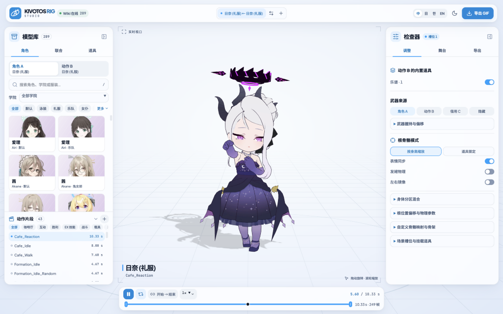
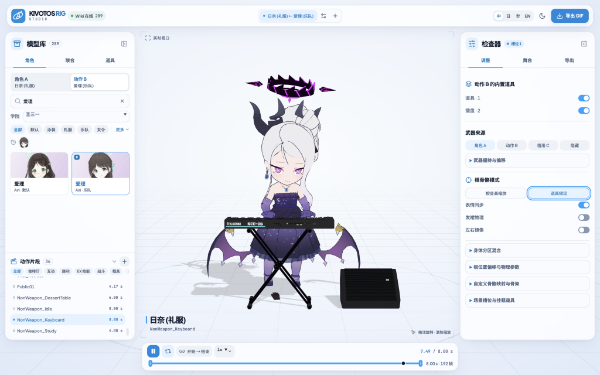
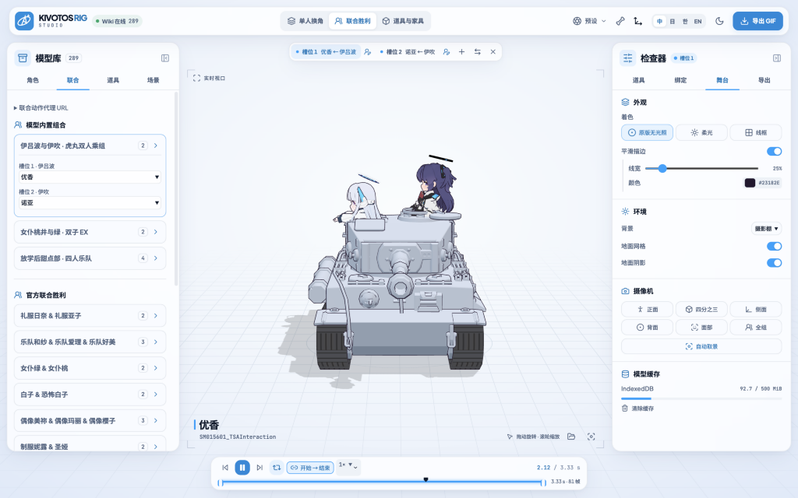
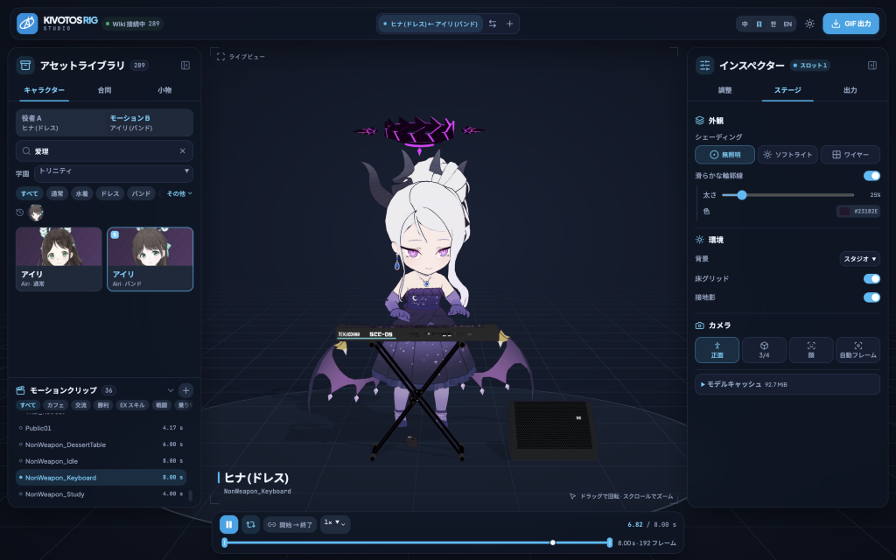
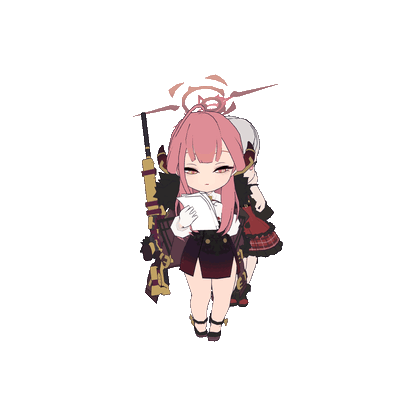
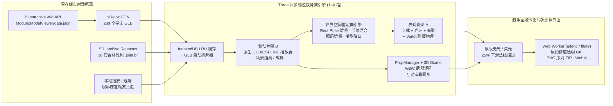

<div align="center">


# KIVOTOS RIG STUDIO

**蔚蓝档案 3D 小人跨角色换骨、全道具与家具交互、多槽位合体胜利换人及原生透明 GIF 导出工作台**

<p>
  <a href="README.md">English</a> ·
  <strong>简体中文</strong> ·
  <a href="README.ja.md">日本語</a> ·
  <a href="README.ko.md">한국어</a>
</p>

<p>
  <a href="https://ryujou.github.io/kivotos-rig-studio/"></a>
  
  
  
  
  
  
</p>

<p>
  <strong>👉 <a href="https://ryujou.github.io/kivotos-rig-studio/">立即在浏览器中在线体验（GitHub Pages）</a></strong>
</p>

<br />



</div>

---

## ✨ 核心特性

- **零模型入库 · 实时直连 Wiki（仓库内 0 个 `.glb`）** — 启动时直接请求 [`bluearchive.wiki`](https://bluearchive.wiki/wiki/Models) 的 `Module:ModelViewer/data.json` 获取最新 145 角色 / 289 模型清单，按需从 jsDelivr CDN 流式加载并自动写入浏览器 IndexedDB LRU 缓存；Wiki 上新学生或换装时网页自动同步。
- **极简「先选目标、整卡单击」与快速角色筛选** — 在左侧顶部选中 **`角色 A（外观）`** 或 **`动作 B（动作源）`** 后直接单击任意角色卡片即可切换；支持按 `/` 秒速多语模糊搜索、**全 145 名学生官方学院快速筛选**、服装/带道具筛选胶囊与**最近使用**快捷栏。
- **双骨架世界空间增量换骨引擎** — **让任意角色 A 流畅演绎任意角色 B 的动作**。采用绑定姿态归一化世界空间四元数重定向，严格保留目标骨长、原生解算 `CUBICSPLINE` 曲线、完美免疫 6 层坦克炮塔嵌套与根轴差异、眼眉局部增量防浮出、`Mouth_XXX` 嘴型支持精确匹配 + 同百位组自动降级。
- **渐进式高级绑骨实验室 & 发裙弹簧物理** — 高频开关（`按身高缩放 / 道具锁定`、`表情同步`、`发裙物理`、`左右镜像`）直接置顶呈现；**7 部位双动作混合**、**自定义逐骨映射 + 3D 骨架透视**、**物理参数微调**与 **3D Gizmo** 整齐收纳于折叠区，一键展开即可精细调校。
- **全量道具、武器矩阵与咖啡厅家具交互** — 自动拆解 Wiki 内 **217 个自带道具/乐器/桌椅/载具的模型**（电子琴、坦克、餐车摩托、沙滩椅、乐谱等）逐部件控显隐；支持 **A / B / C 三方武器切换**；支持直接拖放 **咖啡厅互动家具包**（`.glb` / `.zip` + `pack.json`）或挂接远端目录。
- **16 套官方 2–4 人合体战斗结算 + 一键任意换人** — 内置全部 16 套官方合体胜利编队（及虎丸双人坦克、女仆双子 EX、放课后甜点部 4 人乐队），保留精准站位与 `开始 → 结束` 无缝连播，**任意槽位均可一键替换为 289 名学生中的任意一位**。
- **确定性逐帧导出 · 默认原始精度透明 GIF** — 默认 `1:1` 正方形取景框按动画 5 个关键时刻自动联合算框，完整包住角色、无黑框光环、长武器与道具；默认 **原始精度（1:1 原生 DPR 像素）**，由 Web Worker 运行 `gifenc` 编码，搭配 25% 精细日系描边与纯净透明底，另支持 **PNG 序列 ZIP** 与 **WebM 视频**。
- **现代化 SCHALE 美学 & 日中韩英四语切换** — 单层悬浮顶栏融合槽位控制条、自定义 Pointer-Events 像素对齐时间轴、**SCHALE 亮色** / **Studio 深色**双主题，完整支持 **简体中文 / 日本語 / 한국어 / English** 一键切换。

---

## 🎬 实机效果展示

<table>
  <tr>
    <td width="50%" align="center">
      <br />
      <sub><strong>学院快速筛选 + 跨角色乐器互动</strong> · 礼服日奈 ← 乐队爱理 <code>NonWeapon_Keyboard</code></sub>
    </td>
    <td width="50%" align="center">
      <br />
      <sub><strong>双槽位坦克换角</strong> · 优香 &amp; 诺亚驾驶虎丸（实时跟随炮塔乘位骨骼）</sub>
    </td>
  </tr>
  <tr>
    <td width="50%" align="center">
      <br />
      <sub><strong>双人合体结算 + 自动 1:1 原始精度取景框</strong> · 阿露 &amp; 睦月 · <code>1468×1468</code></sub>
    </td>
    <td width="50%" align="center">
      <br />
      <sub><strong>Studio 深色主题 + 四语界面</strong> · 简体中文 / 日本語 / 한국어 / English 秒级切换</sub>
    </td>
  </tr>
</table>

<div align="center">
  <br />
  <sub><strong>网页实机导出的透明背景 GIF</strong> · 阿露 &amp; 睦月双人胜利结算（25% 精细日系描边、光环无黑框、零杂边）</sub>
</div>

---

## 🧠 系统架构



---

## 🚀 快速开始

**环境要求：** Node.js `>= 20` 与 npm。

```bash
git clone https://github.com/ryujou/kivotos-rig-studio.git
cd kivotos-rig-studio
npm install
npm run dev
```

浏览器打开 **`http://localhost:5173`** 即可使用，无需手动下载任何 `.glb` 模型文件。

> **生产构建与本地预览：**
> ```bash
> npm run build
> npm run preview
> ```

---

## 🎮 使用流程与快捷操作

1. **秒速选角与换骨** — 在左侧 **「角色」** 顶部选择 **`角色 A`** 或 **`动作 B`**，按 `/` 多语搜索或通过 **学院下拉框 / 服装胶囊** 筛选，随后直接单击整张角色卡片完成赋值；顶栏中央可一键 `⇄` 互换 A/B 或点 `+` 扩充至 4 人同屏。
2. **道具与互动家具** — 在 **「道具」** 中浏览 217 套自带乐器/载具/桌椅互动，在右侧 **「调整」** 中切换武器与内置部件开关，或直接将本地 `.glb` / `.zip` 咖啡厅互动家具包拖进 3D 视口。
3. **双人/多人合体结算** — 在 **「联合」** 中一键载入内置组合或 16 套官方合体胜利编队，并可自由将任意槽位替换为其他角色。
4. **原始精度透明 GIF 导出** — 点击顶栏 **「导出 GIF」** 自动开启并贴合 `1:1` 原始精度取景框，在底部时间轴拖动实心裁剪手柄（或点「裁成 3 秒」）即可高速输出透明表情包 GIF。

**快捷键与视口操作：** `/` 聚焦搜索 · `空格` 播放/暂停 · `←` / `→` 逐帧步进 · `左键拖动` 环绕旋转 · `右键拖动` 平移 · `滚轮` 缩放 · 展开 **调整 → 场景槽位与挂载道具** 可启用 3D 移动/旋转/缩放 Gizmo。

---

## 🪑 咖啡厅互动家具包接入

Wiki 模型内自带的 **217 套道具/乐器/载具** 开箱即用；若需导入从游戏 AssetBundle 解包提取的独立咖啡厅互动家具（例如使用 [`ZM-Kimu/Blue-Archive-Asset-Downloader`](https://github.com/ZM-Kimu/Blue-Archive-Asset-Downloader) 或 AssetStudio），可直接将家具 `.glb`、多文件或 `.zip` 互动包拖入 3D 视口或 **道具 → 导入本地家具包 / 借用道具**。

详细 `pack.json` 格式规范请参考 **[tools/README-furniture-extract.md](tools/README-furniture-extract.md)**。

---

## ☁️ GitHub Pages 与静态部署

项目已配置 **[.github/workflows/deploy-pages.yml](.github/workflows/deploy-pages.yml)**，推送至 `main` 分支即自动构建并部署到 **`https://ryujou.github.io/kivotos-rig-studio/`**。

- 全部 289 个 Wiki 学生模型、217 套内置道具以及 3 套内置多人组合在 GitHub Pages 上均开箱即用，无需后端。
- 若需在纯静态站点使用 16 套官方 `.joint.br` 合体胜利包，可在 **「联合 → 离线文件 / 代理」** 中拖入本地文件，或部署自带的 **[deploy/cloudflare-worker.js](deploy/cloudflare-worker.js)** 并填入代理地址（本地 `vite dev` / `vite preview` 已内置 `/api/joint/*` 代理）。

---

<details>
<summary><strong>📁 项目结构</strong></summary>

```text
kivotos-rig-studio/
├── .github/workflows/
│   └── deploy-pages.yml            # GitHub Pages 自动构建与部署工作流
├── deploy/
│   └── cloudflare-worker.js        # 纯静态部署可选的 .joint.br 跨域代理模板
├── docs/media/                     # README 实机截图与透明 GIF 演示
├── public/                         # 光环图标、角色头像图集、Brotli 许可
├── src/
│   ├── components/                 # TopBar、LeftDrawer、RightInspector、AdjustInspector、TimelineDock、CropOverlay、ExportModal
│   ├── data/                       # Wiki 离线兜底目录、217 道具索引、16 套合体编队
│   ├── engine/                     # 场景管理、GLB 拆解、25% 平滑描边、双骨架重定向、弹簧物理、道具管理、GIF 导出
│   ├── i18n/                       # 中/日/韩/英全量界面词典 + 145 学生、学院与服装变体多语名
│   ├── services/                   # Wiki 实时拉取、IndexedDB 缓存、合体包加载、家具包解析
│   ├── store/                      # Zustand 多槽位状态管理与导出会话
│   └── workers/                    # Web Worker 异步 gifenc 编码与 fflate PNG 打包
├── tools/
│   └── README-furniture-extract.md # 咖啡厅互动家具包制作与解包说明
└── vite.config.ts                  # Vite + Tailwind v4 + BASE_PATH + /api/joint/* Brotli 解压代理
```

</details>

---

## 🙏 致谢与免责声明

- **3D 模型源与渲染参考：** [`bluearchive.wiki`](https://bluearchive.wiki/wiki/Models)、[`lihaohong6/BlueArchiveModels`](https://github.com/lihaohong6/BlueArchiveModels)、[`lihaohong6/MirahezeDevScripts`](https://github.com/lihaohong6/MirahezeDevScripts)
- **合体胜利编队与动作调研参考：** [`dxsworks/SD_archive`](https://github.com/dxsworks/SD_archive)
- **核心开源依赖：** [Three.js](https://threejs.org/)、[React](https://react.dev/)、[Zustand](https://zustand-demo.pmnd.rs/)、[gifenc](https://github.com/mattdesl/gifenc)、[fflate](https://github.com/101arrowz/fflate)、[Lucide](https://lucide.dev/)

> **免责声明：** 本项目为非官方、非商业性质的同人技术工具，与 NEXON Games 及 Yostar 没有任何关联。《蔚蓝档案》相关角色、3D 模型与动作版权均归原权利方所有；本代码仓库不包含任何受版权保护的游戏模型二进制文件。

## 📄 开源协议

基于 [MIT License](LICENSE) 开源。
