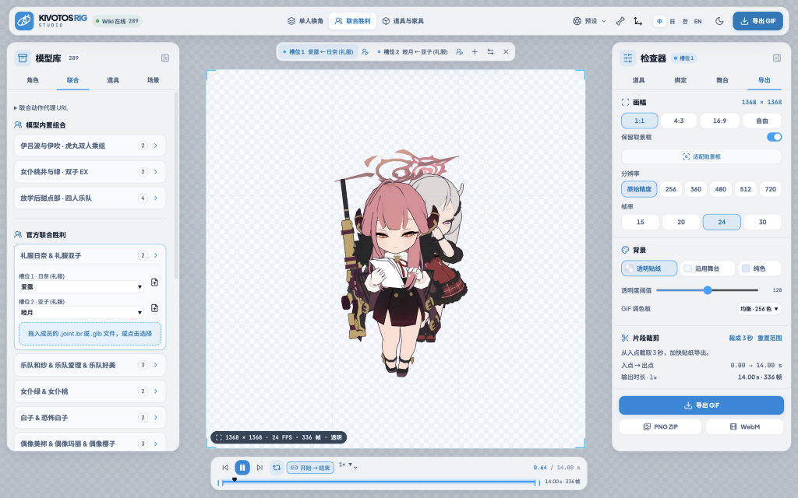
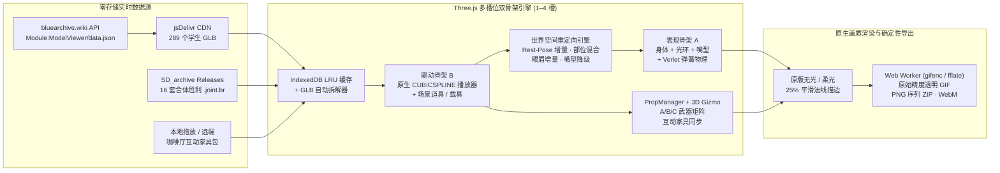

<div align="center">


# KIVOTOS RIG STUDIO

**蔚蓝档案 3D 小人跨角色换骨、全道具与家具交互、多槽位合体胜利换人及原生透明 GIF 导出工作台**

<p>
  <a href="README.md">English</a> ·
  <strong>简体中文</strong> ·
  <a href="README.ja.md">日本語</a> ·
  <a href="README.ko.md">한국어</a>
</p>

<p>
  
  
  
  
  
  
</p>

<br />


</div>

---

## ✨ 核心特性

- **零模型入库 · 实时直连 Wiki（仓库内 0 个 `.glb`）** — 启动时直接请求 [`bluearchive.wiki`](https://bluearchive.wiki/wiki/Models) 的 `Module:ModelViewer/data.json` 获取最新 145 角色 / 289 模型清单，按需从 jsDelivr CDN 流式加载并自动写入浏览器 IndexedDB LRU 缓存；Wiki 更新新学生或换装时网页自动同步。
- **双骨架世界空间增量换骨引擎** — **让任意角色 A 流畅演绎任意角色 B 的动作**。采用绑定姿态归一化（Rest-Pose Normalized）世界空间四元数重定向，严格保留目标角色骨长、原生保真解算 GLTF `CUBICSPLINE` 曲线、完美免疫 6 层坦克炮塔嵌套与根轴差异、眼眉采用局部增量防眼球飞出、`Mouth_XXX` 嘴型支持精确匹配 + 同百位组自动降级。
- **自定义绑骨实验室 & 头发裙摆弹簧物理** — 支持将 **7 大身体部位**（头部、面部、左臂、右臂、躯干、双腿、武器）在动作源 B / 角色 A 自带动作 / 静止锁定间自由拼接；内置可搜索逐骨映射表与一键左右镜像（`L ↔ R`）+ 3D 骨架高亮；对未映射的长发、裙摆、翅膀、尾巴、飘带接入 Verlet 弹簧物理。
- **全量道具、武器矩阵与咖啡厅家具交互** — 自动拆解 Wiki 内 **217 个自带道具/乐器/桌椅/载具的模型**（电子琴、坦克、餐车摩托、沙滩椅、乐谱等）并逐部件控制显隐；提供 **A / B / C 三方武器切换** + 握持位姿微调 + 3D `TransformControls` 拖拽 Gizmo；支持拖放导入 **咖啡厅互动家具包**（`.glb` / `.zip` + `pack.json`）及远端家具包目录。
- **16 套官方 2–4 人合体战斗结算 + 一键任意换人** — 内置全部 16 套官方合体胜利编队（及伊吕波×伊吹虎丸双人坦克、女仆双子 EX、放课后甜点部 4 人乐队），保留精准站位与 `Start → End` 无缝连播，**任意槽位均可一键替换为 289 名学生中的任意一位**。
- **确定性逐帧导出 · 默认原始精度透明 GIF** — 默认 `1:1` 正方形取景框按动画 5 个关键时刻自动联合算框，完整包住角色本体、光环、长武器与道具；默认 **原始精度（1:1 原生 DPR 像素）**，由 Web Worker 运行 `gifenc` 编码，透明底抠像无黑边不拖影，同时支持 **PNG 序列 ZIP** 与 **WebM 视频**。
- **现代化 SCHALE 美学 & 日中韩英四语切换** — SCHALE 陶瓷亮色 / Studio 深空暗色双主题磨砂玻璃界面，完整支持 **简体中文 / 日本語 / 한국어 / English** 一键切换（覆盖全部 271 项界面文本与 145 名学生及服装变体的多语检索）。

---

## 🎬 实机效果展示

<table>
  <tr>
    <td width="50%" align="center">
      <br />
      <sub><strong>跨角色换骨 + 乐器道具联动</strong> · 礼服日奈 ← 乐队爱理 <code>NonWeapon_Keyboard</code></sub>
    </td>
    <td width="50%" align="center">
      <br />
      <sub><strong>双槽位坦克换角</strong> · 优香 &amp; 诺亚驾驶虎丸（实时跟随炮塔乘位骨骼）</sub>
    </td>
  </tr>
  <tr>
    <td width="50%" align="center">
      <br />
      <sub><strong>双人合体结算 + 自动 1:1 取景框</strong> · 阿露 &amp; 睦月 ← 礼服日奈 &amp; 亚子 · <code>1368×1368</code></sub>
    </td>
    <td width="50%" align="center">
      <br />
      <sub><strong>Studio 深色主题 + 四语界面</strong> · 简体中文 / 日本語 / 한국어 / English 秒级切换</sub>
    </td>
  </tr>
</table>

<div align="center">
  <br />
  <sub><strong>网页实机导出的透明背景 GIF</strong> · 阿露 &amp; 睦月双人胜利结算（25% 精细日系描边、光环无黑框、零杂边）</sub>
</div>

---

## 🧠 系统架构



---

## 🚀 快速开始

**环境要求：** Node.js `>= 20` 与 npm。

```bash
git clone https://github.com/ryujou/kivotos-rig-studio.git
cd kivotos-rig-studio
npm install
npm run dev
```

浏览器打开 **`http://localhost:5173`** 即可使用，无需手动下载任何 `.glb` 模型文件。

> **生产构建与本地预览：**
> ```bash
> npm run build
> npm run preview
> ```

---

## 🎮 内置名场面预设与操作指南

点击顶栏 **「预设」** 即可一键体验各种跨角色互动组合：

| 预设名称 | 展示亮点 |
| :--- | :--- |
| **日奈弹爱理的键盘** | 道具锁定模式跨角色换骨 + 电子琴、琴架、踏板与音箱同步动画 |
| **爱丽丝开切里诺的坦克** | 跨越 6 层坦克炮塔嵌套与根骨骼旋转轴差异的精准重定向 |
| **梓骑风香的餐车** | 37 骨骼大型载具道具联动（`CH0177_FoodBike_Outline`） |
| **优香与诺亚双人虎丸** | 双槽位换人搭乘伊吕波×伊吹虎丸坦克（副驾实时跟随炮塔 `St_point`） |
| **阿露与睦月双人胜利** | 实时 `/api/joint/*` Brotli 代理 + 官方双人合体胜利换角 + `开始 → 结束` 连播 |
| **星野的未花风格战斗** | 战斗换骨 + A/B/C 三方武器切换 + 发裙弹簧物理 |

**视口交互：** `左键拖动` 环绕旋转 · `右键拖动` 平移 · `滚轮` 缩放 · 开启顶栏 Gizmo（移动 / 旋转 / 缩放）后可在 3D 视口内直接拖拽微调任意角色槽位或道具位置。

---

## 🪑 咖啡厅互动家具包接入

Wiki 289 模型内自带的 **217 套道具/乐器/载具** 开箱即用；若需导入从游戏 AssetBundle 解包提取的独立咖啡厅互动家具（例如使用 [`ZM-Kimu/Blue-Archive-Asset-Downloader`](https://github.com/ZM-Kimu/Blue-Archive-Asset-Downloader) 或 AssetStudio），可直接将家具 `.glb`、多文件或 `.zip` 互动包拖入左侧 **「道具」** 标签页，或填写自定义远端目录 URL。

详细打包格式与 `pack.json` 规范请参考 **[tools/README-furniture-extract.md](tools/README-furniture-extract.md)**。

---

## ☁️ 静态站点部署（GitHub Pages / Cloudflare Pages）

全部 289 个 Wiki 模型与目录接口均原生支持浏览器跨域，可直接纯静态部署。由于 GitHub Releases 的 16 套 `.joint.br` 合体动作包跳转不带 CORS 头，本地 `vite dev` / `vite preview` 已内置 `/api/joint/*` 透明代理；若部署到纯静态站点，只需部署项目自带的 **[deploy/cloudflare-worker.js](deploy/cloudflare-worker.js)**，并在界面 **「联合 → 联合动作代理 URL」** 中填入 Worker 地址即可。

---

<details>
<summary><strong>📁 项目结构</strong></summary>

```text
kivotos-rig-studio/
├── deploy/
│   └── cloudflare-worker.js        # 纯静态部署可选的 .joint.br 跨域代理模板
├── docs/media/                     # README 实机截图与透明 GIF 演示
├── public/                         # 光环图标、角色头像图集、Brotli 许可
├── src/
│   ├── components/                 # 顶栏、槽位条、左侧库、右侧检查器、时间轴、取景框、导出弹窗
│   ├── data/                       # Wiki 离线兜底目录、217 道具索引、16 套合体编队、预设
│   ├── engine/                     # 场景管理、GLB 拆解、平滑描边、双骨架重定向、弹簧物理、道具管理、GIF 导出
│   ├── i18n/                       # 中/日/韩/英全量界面词典 + 145 学生与服装变体多语名
│   ├── services/                   # Wiki 实时拉取、IndexedDB 缓存、合体包加载、家具包解析
│   ├── store/                      # Zustand 多槽位状态管理与导出会话
│   └── workers/                    # Web Worker 异步 gifenc 编码与 fflate PNG 打包
├── tools/
│   └── README-furniture-extract.md # 咖啡厅互动家具包制作与解包说明
└── vite.config.ts                  # Vite + Tailwind v4 + /api/joint/* Brotli 解压代理
```

</details>

---

## 🙏 致谢与免责声明

- **3D 模型源与渲染参考：** [`bluearchive.wiki`](https://bluearchive.wiki/wiki/Models)、[`lihaohong6/BlueArchiveModels`](https://github.com/lihaohong6/BlueArchiveModels)、[`lihaohong6/MirahezeDevScripts`](https://github.com/lihaohong6/MirahezeDevScripts)
- **合体胜利编队与动作调研参考：** [`dxsworks/SD_archive`](https://github.com/dxsworks/SD_archive)
- **核心开源依赖：** [Three.js](https://threejs.org/)、[React](https://react.dev/)、[Zustand](https://zustand-demo.pmnd.rs/)、[gifenc](https://github.com/mattdesl/gifenc)、[fflate](https://github.com/101arrowz/fflate)、[Lucide](https://lucide.dev/)

> **免责声明：** 本项目为非官方、非商业性质的同人技术工具，与 NEXON Games 及 Yostar 没有任何关联。《蔚蓝档案》相关角色、3D 模型与动作版权均归原权利方所有；本代码仓库不包含任何受版权保护的游戏模型二进制文件。

## 📄 开源协议

基于 [MIT License](LICENSE) 开源。
